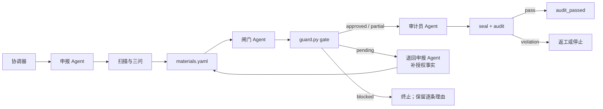

# DistillGuard 多 Agent 运行说明

多 Agent 处理三个紧密相连的职责：材料申报、入库闸和出厂审计。它不把 deterministic gate
换成模型判断，也不额外调度下游蒸馏 Agent。

## 角色

| 角色 | 能做 | 不能做 |
|---|---|---|
| 申报 Agent `declaration_agent` | 扫描材料、提出三问、生成清单、接收挂起项并组织下一次补充 | 放行材料、修改规则、替用户猜测第三人或授权事实 |
| 闸门 Agent `gate_agent` | 调用 `guard.py gate`、读取结构化结果、解释待补项和拦截理由 | 绕过规则、把 pending 改成 approved、继续未获批的下游 |
| 审计员 Agent `audit_agent` | 调用 `seal` 与 `audit`、读取调用日志、报告越界或返工项 | 修改技能包、删除证据、把审计失败改成通过 |
| 协调器 `coordinator` | 初始化共享状态、传递任务和结果、选择退出码 | 对材料作业务判断 |



## 状态流

```text
initialized
  -> declaration_awaiting_answers
  -> manifest_ready
  -> gate_approved / gate_partial_blocked / gate_pending / gate_blocked
  -> awaiting_consent_or_revision   # 仅 pending
  -> audit_pending                  # approved / partial
  -> audit_passed / audit_violation / audit_error
```

完全 `blocked` 是终止状态。申报 Agent 可以请求删除第三人或私人部分后重新扫描，但闸门 Agent
不会因为收到解释而直接放行。部分批准时，审计员仍会检查被拦截材料是否混入获批包的产出。

## 运行

在仓库根目录执行：

```bash
# 交互提问
python -m agents run \
    --src examples/case_pass/raw \
    --workspace ../agent_demo/pass

# 使用固定答案做回归演示
python -m agents run \
    --src examples/case_pending/raw \
    --workspace ../agent_demo/pending \
    --answers examples/agent/pending_answers.yaml

# 闸门返回 pending 后，只在同一工作区提交补充事实
python -m agents revise \
    --workspace ../agent_demo/pending \
    --answers ../path/to/revised_answers.yaml

# 批准后自动审计
python -m agents run \
    --src examples/case_pass/raw \
    --workspace ../agent_demo/audit \
    --answers examples/agent/pass_answers.yaml \
    --package ../agent_demo/audit/package

# 对已有批准工作区单独启动审计员
python -m agents audit \
    --workspace ../agent_demo/audit \
    --package ../agent_demo/audit/package

# 只运行申报 Agent
python -m agents survey \
    --src examples/case_block/raw \
    --workspace ../agent_demo/survey

# 只运行闸门 Agent
python -m agents gate \
    --manifest examples/case_pass/materials.yaml \
    --src examples/case_pass/raw \
    --workspace ../agent_demo/gate
```

退出码沿用闸门约定：`0` 全部放行，`2` 存在拦截，`3` 存在挂起。

协调器使用受控状态迁移。`revise` 只接受处于 `awaiting_consent_or_revision` 的工作区；
每次修订增加一轮编号，前一轮的清单和闸门结果不会被覆盖。

## 共享状态

每次运行会生成：

| 文件 | 用途 |
|---|---|
| `agent_state.json` | 当前阶段、三个 Agent 的状态、产物路径和最近消息 |
| `agent_messages.jsonl` | Agent 之间的任务、交接、退回和最终结果 |
| `agent_tools.jsonl` | 每次 `guide.py` / `guard.py` 调用的命令、退出码和输出 |
| `declaration/draft.yaml` | 申报 Agent 扫描出的材料草稿 |
| `declaration/questions.md` | 三问问卷 |
| `declaration/round-N/materials.yaml` | 第 N 轮交给闸门 Agent 的正式清单 |
| `gate/round-N/run.json` | 第 N 轮确定性闸门的逐材料结果 |
| `gate_summary.json` | 供协调器和后续组件读取的压缩摘要 |
| `audit_summary.json` | 封条、审计退出码、签发编号和审计说明 |

`agent_state.json` 还保存 `thread_id`、当前轮次、状态迁移历史、闸门历史和审计历史。所有消息
携带同一 `thread_id` 与轮次，便于在答辩时还原 Agent 之间的完整协作过程。

## 审计边界

审计员只接受 `gate_approved`、`gate_partial_blocked` 或待返工阶段。它不能把被拦截材料从
工作区取出，也不能删除调用日志。`audit_violation` 后可以修好技能包并重新运行 `audit`；
最终结论始终以 `seal`、`audit` 的退出码和产物为准。

## 模型接口

当前实现是规则驱动的多 Agent，不需要训练或模型 API：每个 Agent 都有明确目标、工具、状态和
停止条件，但决策策略是固定的。若以后接入大模型，只允许模型决定“下一步问什么、何时调用工具”，
不得让模型覆盖 `guard.py` 的 approved、pending、blocked 结果。
